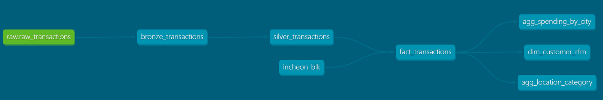

# Incheon Card Transaction Analytics — Snowflake + dbt ELT Pipeline

Production-scale ELT pipeline built during my **Data Analyst internship at Novelsoft (2026)**.
It loads **263.96 million card transactions** (synthetic Hana Bank card data for Incheon, 2023 – 2024, 11 GB in 53 CSV files) into **Snowflake** and
models them with **dbt** in a bronze → silver → gold (medallion) architecture that feeds a three-page **Tableau** dashboard.



## Architecture

| Step | What happens | Tools |
|---|---|---|
| **Extract** | 53 source CSVs stay in Google Drive and are processed in Google Colab — nothing is downloaded to a laptop | Google Drive, Colab |
| **Load** | Each file is gzip-compressed, `PUT` into a Snowflake internal stage and bulk-loaded with `COPY INTO` into `raw.raw_transactions` (untransformed) | Snowflake |
| **Transform** | dbt models build the bronze, silver and gold layers as SQL tables, with 48 schema tests | dbt Core |
| **Serve** | Pre-aggregated gold tables power the Tableau dashboard | Tableau |

Cost control on a Snowflake trial budget: gzip staging, warehouse auto-suspend, and small pre-aggregated gold tables so
dashboards never scan the 264M-row fact table.

## dbt models (`incheon_db/`)

| Layer | Model | Purpose |
|---|---|---|
| Bronze | `bronze_transactions` | Raw records as loaded; drops rows without customer ID or approval date |
| Silver | `silver_transactions` | Parses `YYYYMMDD` dates, decodes gender, 19 home-region codes and 21 merchant categories into English, adds category groups and a visitor type (Incheon local / domestic / foreign) |
| Seed | `incheon_blk` | 24,608 Incheon block IDs with latitude / longitude (Korea public data portal) |
| Gold | `fact_transactions` | One row per transaction, enriched with coordinates, day of week and weekday / weekend flag |
| Gold | `agg_spending_by_city` | Monthly spend by home city, visitor type, gender, age group, day and category → *Market Overview* page |
| Gold | `agg_location_category` | Spend in ~1.1 km coordinate zones by category and visitor type → *Location Intelligence* page |
| Gold | `dim_customer_rfm` | One row per customer: recency, frequency and monetary quintile scores (NTILE) and 8 rule-based segments → *Customer Intelligence* page |

Every model and column is documented in [`models.yml`](incheon_db/models/models.yml); tests cover `not_null` on key
columns and `unique` on the customer dimension.

## Key results (Tableau dashboard)

- **Market:** ₩8,654.8B total spend across 263.96M transactions, **+5.33% year over year**; Saturday revenue is 34% above the weekday average; retail and food & dining make up ~50% of spend.
- **Location:** 70 active spending zones; the Incheon Airport zone alone generates ₩634.2B (7.3% of the market) with a 68.4% foreign-visitor share.
- **Customers:** 12.31M unique customers segmented by RFM; *Champions* (22% of customers) spend about 4× the average customer.

## Code review fixes in this repository

- `fact_transactions.week_type` originally flagged `DAYOFWEEK IN (1, 7)` as weekend, which marks **Monday** as weekend and **Sunday** as a weekday
  (Snowflake's `DAYOFWEEK` returns 0 = Sunday … 6 = Saturday). It now uses the session-independent `DAYOFWEEKISO` (1 = Monday … 7 = Sunday)
  with weekend = 6, 7. The `day_name` column and the Saturday finding above were already correct; any weekday-vs-weekend split in the
  dashboard should be refreshed after re-running `dbt build`.
- Column documentation updated to match the SQL (day-of-week convention, RFM score direction, the `Other` visitor type).
- In the Airbnb project, the `dim_hosts` documentation referred to columns that the model renames; it now documents `host_id` / `host_name` and tests `host_id` for uniqueness.

Both projects parse cleanly with dbt-core 1.11 (`dbt parse`).

## Airbnb practice project (`airbnb_dbt_practice/`)

The dbt training project that preceded the capstone: Airbnb listings, hosts and reviews in Snowflake modelled as
staging → dimension / fact tables, a **type-2 slowly changing dimension snapshot** of hosts (`scd_raw_hosts`), a seed table
and model documentation.

## How to run

```bash
pip install -r requirements.txt
cp profiles.example.yml ~/.dbt/profiles.yml        # then set SNOWFLAKE_* environment variables
cd incheon_db
dbt seed        # load the block-coordinate reference table
dbt build       # run all models and tests
dbt docs generate && dbt docs serve
```

The models expect the raw table `incheon_db.raw.raw_transactions` to be loaded first (see *Architecture*).
The transaction data itself is not included in this repository (11 GB).

## Tech stack

Snowflake · dbt Core · SQL · Jinja · Google Colab · Tableau
